# Terra Studio

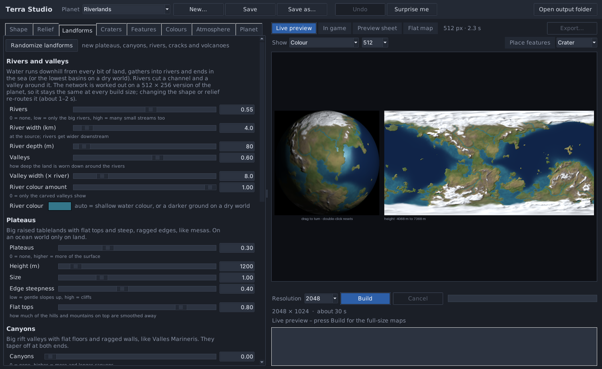

Terra Studio makes rocky planets and moons for Kerbal Space Program planet mods
(Kopernicus): a height map, a colour map and a normal map that fit together, plus a
ready Kopernicus config with the right offset and deformity. Continents and oceans,
mountain ranges, plateaus, canyons, rivers and valleys, craters, volcanoes, cracks,
polar caps and snow: you set them with sliders and see the planet change a moment later.
It also makes a Scatterer atmosphere for the planet and shows how it looks in game.

Everything is made from 3D noise on the sphere, so there is no seam at the edge of the
map and nothing pinches together at the poles.

It is the sister program of Gas Giant Studio and works the same way.

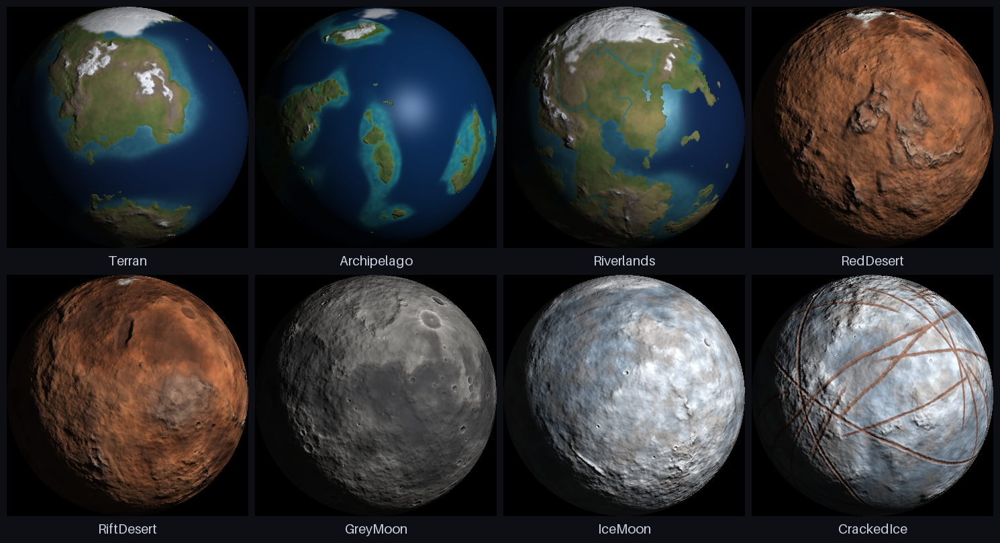

## Download and start

**Windows:** download `TerraStudio-<version>-windows-x64.zip`, unzip it anywhere and
start `TerraStudio.exe`. You don't need to install Python.

**From source (any system):** install Python 3.9 or newer, then

```
pip install numpy pillow
python terrain_ui.py
```

On Windows you can also double-click `Run Terra Studio.bat`. It installs numpy and
Pillow the first time.

Some antivirus programs are suspicious of new, unsigned apps made with PyInstaller. If
yours complains, you can run Terra Studio from source instead; it's the same program.

## What it can do

- **Shape:** ocean on or off, how much land there is, how many continents, how bent
  they are (Twist), how different in size they are, whether the land gathers near the
  equator or near the poles, how ragged the coasts are, and islands. Without an ocean,
  "land" means the highlands and the rest are low basins, like the dark plains on a moon.
- **Relief:** the height range in metres (highest point and lowest point), mountains
  (long ranges, their size, area and sharpness), ranges that follow the coasts, hills,
  flat plains, fine roughness, the width of the shallow shelf around the coasts, and how
  strong the relief looks in the preview. The normal map is made the way GIMP's
  Filters → Generic → Normal Map makes it from the height map; **Normal map scale** is
  GIMP's Scale (default 10).
- **Landforms:**
  - **Rivers and valleys:** water runs downhill from all the land, gathers into rivers
    that join and get wider downstream, and ends in the sea (or the lowest basins on a dry
    world). Rivers cut a channel and wear a valley around it. The river network is worked
    out on a 512 x 256 version of the planet, so it is the same at every build size. River
    colour: water, or your own colour (a dry riverbed, say).
  - **Plateaus:** raised tablelands with flat tops and steep, ragged edges.
  - **Canyons:** big rift valleys with a flat floor, a depth and a width in km.
  - **Equatorial ridge:** one long mountain wall around the planet, like on Iapetus, Pan or
    Atlas. Height, width, how far around it goes, where it sits (centre longitude, latitude
    shift, tilt), gaps, a ragged crest and how much it weaves. Craters still cut into it.
  - **Cracks:** long crossing lines like on Europa, or a network of polygon cells. Each
    crack is a groove with raised edges if you like, and gets its own colour.
  - **Volcanoes:** random shield volcanoes (count, size, height, summit crater).
- **Craters:** how many, the smallest and largest size in km, the mix of small and big
  ones, depth, how many are fresh and how many old and worn down, bright ejecta and soft
  ray streaks around the young ones. Big craters get a flat floor and a central peak.
  Rims are soft, never outlined. Crater floors and ejecta can have their own colours.
- **Features:** your own craters, basins, volcanoes, mountains and plateaus exactly where you want
  them. Turn on **Place features** above the preview, pick the kind and click the flat map
  or the globe. Drag to move, right-click to remove. Each one has a card with its
  latitude, longitude, size in km, height or depth and freshness.
- **Colours:** a colour for each height (sea floor, lowlands, highlands, peaks), a height
  blur so the colours don't follow contour lines, patches, a dry belt and a cold tint by
  latitude, rock on steep slopes, separate north and south polar caps with a ragged edge,
  how far sea ice reaches, a snow line that drops towards the poles, the shallow and deep
  water colours, volcanic rock, and brightness, contrast and saturation for the whole map.
- **Colour picker:** click any colour box for a colour picker with a colour square, hex
  and RGB, the planet's other colours, recent colours, **Pick from screen** (an eyedropper
  for anything on your screen) and **Pick from picture...**. **Colours from picture...**
  under the height colours takes a whole set at once: click the low end, then the high end
  of a line across a photo (a beach up to a snowy peak, say), and the colours along the
  line become the colours by height.
- **Lava plates:** for worlds close to their star, the crust is torn into tilted plates with
  glowing lava between them. The plates get smaller and the lava channels wider towards the
  hottest point, which is an open lava sea with floating rafts of crust. **All over** tears the
  whole crust instead (for tidally heated moons), and lava pools can be added anywhere in the
  torn area. The glow goes into an emissive map that the previews show too.
- **Flowed lava:** the second lava style, like Anneheg in the Kcalbeloh System. Lava fills the low
  ground (below a lava level, or the whole sea on a planet with an ocean) and its surface is worked
  out as if it had really flowed: currents, eddies and streams along the shores stretch it into
  streaks and fold it into swirls. The molten lava glows red at the shore and hotter further out,
  with floes of crust and thin glowing cracks; the rest has cooled into rock that keeps the flow
  lines, as streaks of colour and low frozen ridges.
- **Lava oceans and rivers:** fill the oceans with lava (floating crust, glowing shores) and let
  the rivers, cracks and volcanoes glow. Everything that glows goes into one emissive map.
- **Atmosphere:** a Scatterer atmosphere with Scatterer's own values (HR, m_betaR, HM,
  BETA_MSca, m_mieG, ozone, config points with their exposures and so on). Start from the
  stock Kerbin, Duna, Eve or Laythe air, fitted to your planet's size, or from the planet's
  own colours. The **In game** view shows the planet with that atmosphere the way KSP's
  map view does, relief and all, as a whole planet or close up at the day-side or sunset
  edge. **Load from Scatterer config...** reads an existing atmo.cfg, and the tab gives
  you the atmo.cfg and the planet list entry to paste or save.
- **Clouds:** volumetric clouds for EVE and True Volumetric Clouds, swirled and streaky like
  Edmunds': a fair-weather layer, weather systems that come and go over the hours, and high
  cirrus. Set the cloud cover in percent of the planet, or press **Randomize clouds**. The
  **Clouds** view shows them over the planet. Export writes all the maps and the EVE config.
- **Aurora:** polar lights around each magnetic pole: curtains with rays, a lower fringe
  and bright cores, plus the red and purple top part. Set the magnetic tilt, the size and
  wobble of the oval, the number, spacing and width of the curtains, gaps, rays, glow,
  brightness and all six colours. The **Aurora** view shows both poles from above. Export
  writes the two textures and an EVE config that stacks them as thin layers at different
  heights, so the aurora has depth when you see it from the side.
- **Hazard map:** lava, or a deadly sea of any liquid, heats craft that come near it (Kopernicus'
  HazardousBody). Export writes the heat map and the config node.
- **Rings:** a Kopernicus ring with wide zones, ringlets, gaps, soft edges and three
  colours (auto from the planet's colours). The Rings tab shows the planet with its rings
  and ring shadow. Build writes the ring texture; Export saves it and adds the Rings node to
  the Kopernicus config.
- **Live preview:** the planet as a globe and a flat map, updated by itself after every
  change. Drag the globe to turn it, double-click to reset it. Move the mouse over the map
  to read the latitude and the height there. **Show** switches between colour, colour
  without shading, and the height map.
- **Randomize:** every tab has its own Randomize button. **Surprise me** randomizes
  everything at once, and **Undo** (or Ctrl+Z) goes back.
- **Sizes:** 512, 1024, 2048, 4096 and 8192 pixels wide. A 4096 map takes about a minute.

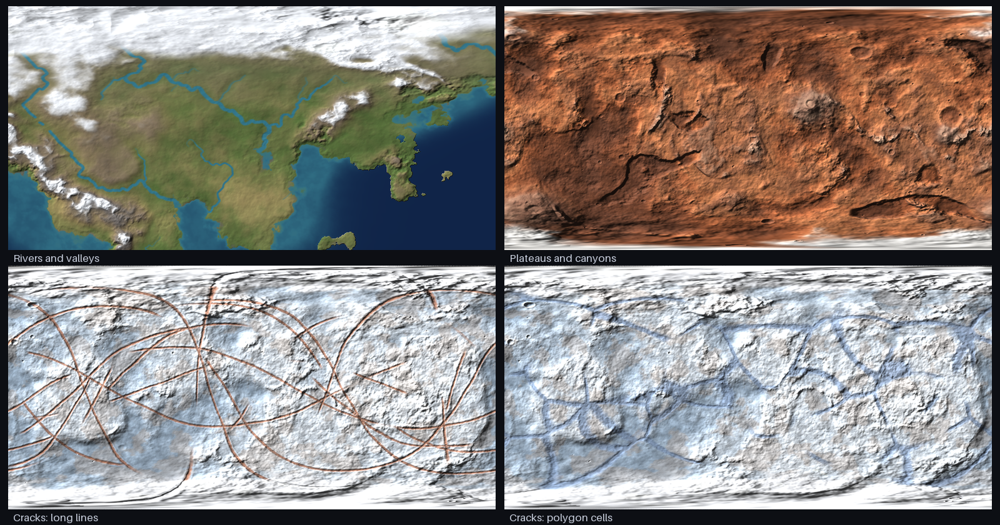

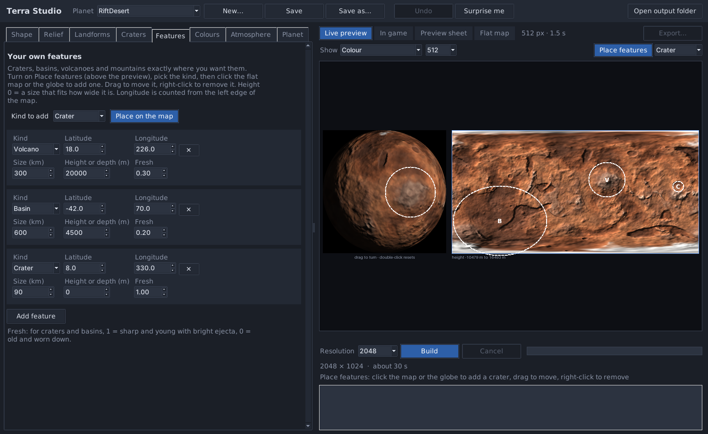

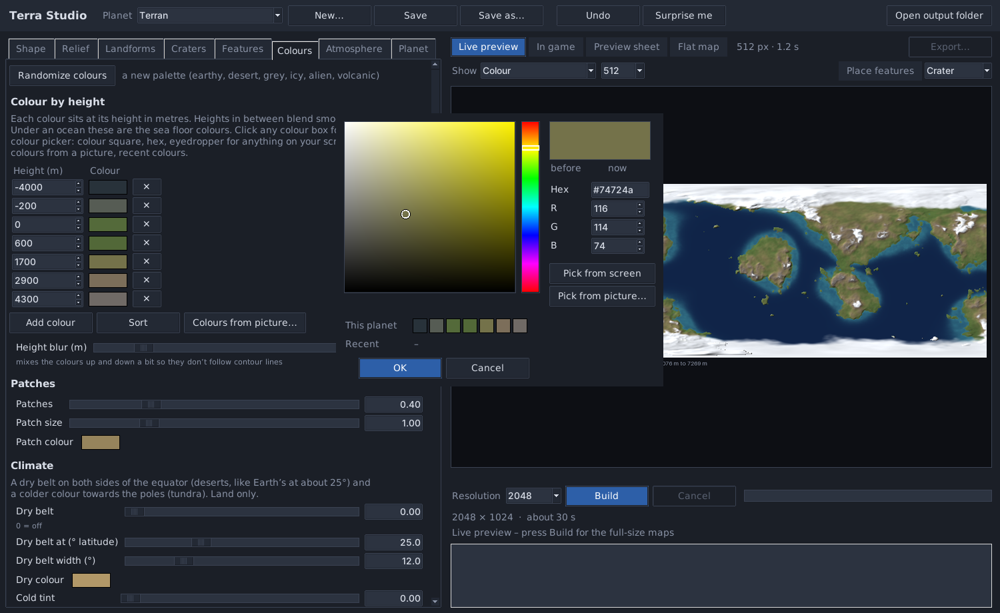

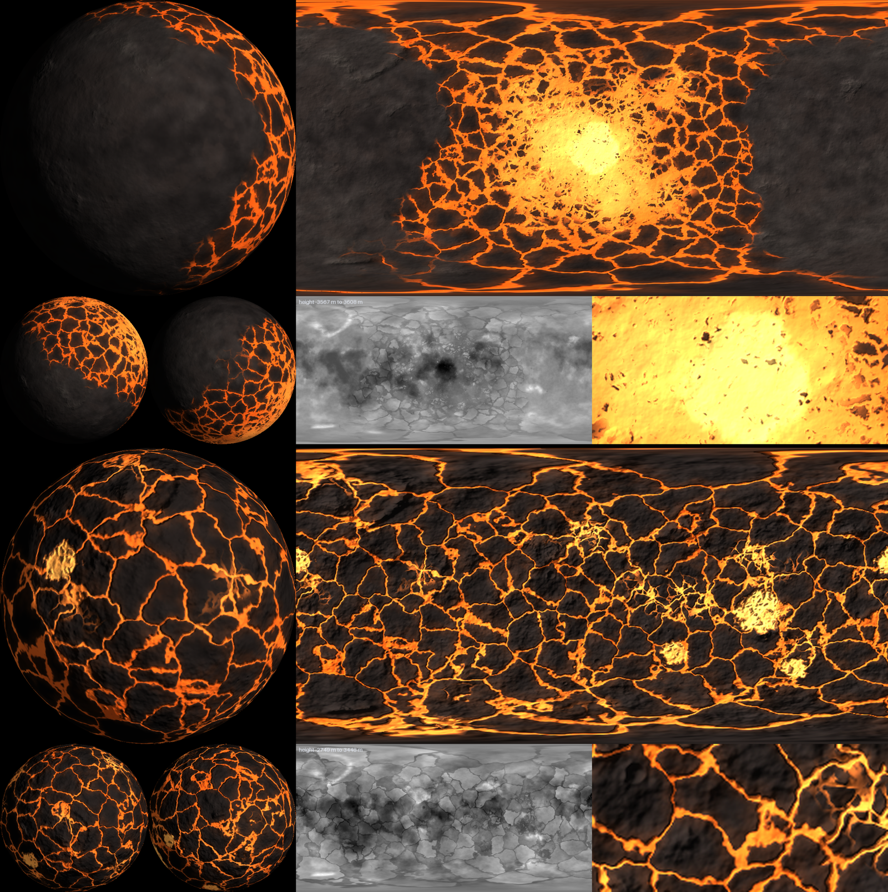

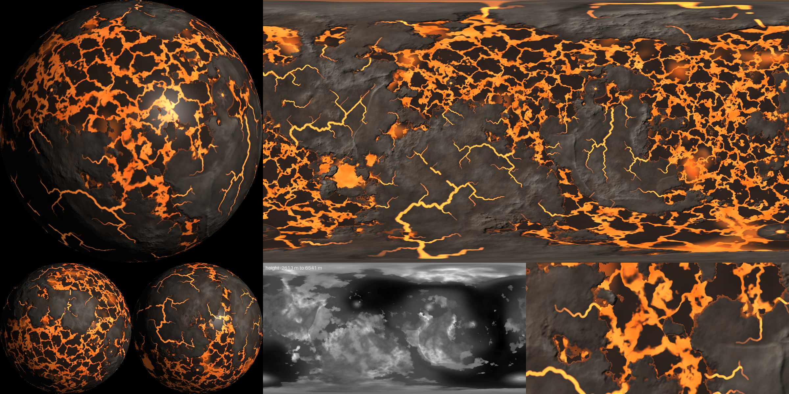

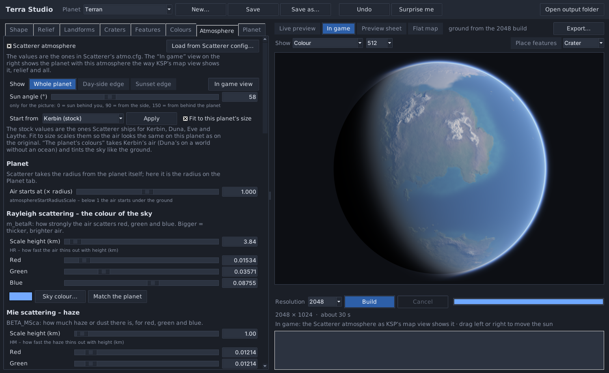

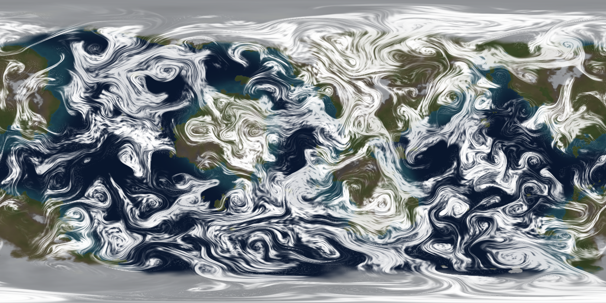

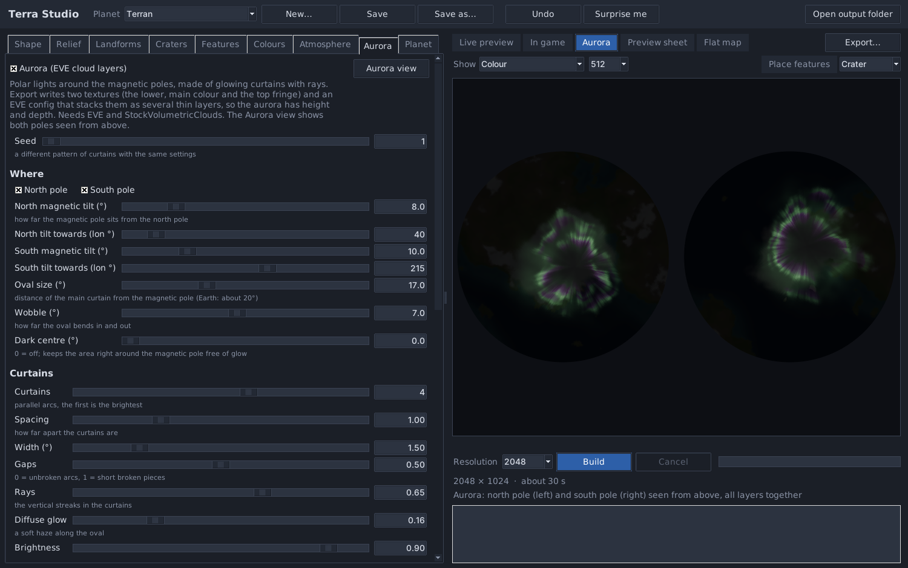

## Biome maps

**Biome maps...** at the top opens the Biome Map Maker. Each biome has a name, a science value, a colour and
rules for where it goes: in the ocean, on the shores, on land, on ice and snow, on glowing lava,
in big craters, in a placed feature, a height range, a slope range and a latitude range
(for both hemispheres or just one). A spot gets the first biome in the list whose rules fit, so put the
special biomes first and a catch-all last; leave a field empty for no limit. **Paint** puts the chosen biome
anywhere with a brush, **Erase** gives the spot back to the rules. The map shows the biomes over the planet and
their share of the surface; the first time it suggests a set from the build. Export to mod on the Config
tab writes the biome map and the Biomes node; **Save biome map...** and **Copy Biomes node** give them to you
on their own, and **Export...** has a Biome map row too (its Kopernicus config then gets biomeMap and the
Biomes node). The biome map is a DDS with an 8-bit (256-colour) palette, which Kopernicus reads with the exact
biome colours and GIMP can open; Save biome map... and Export... can also
write a PNG. Heights are above sea level. **In big craters** takes the craters of at least the size you give
that can still be seen in the build, plus your placed craters and basins. Craters buried under lava flows or
later craters, or worn too flat to stand out from the ground around them, are left out. Under a lava or water
sea a crater counts only when its rim shows as a ring around it, and next to glowing lava only when most of
its rim is clear of the lava. **Relief** shades the map with the heights, so craters show even where flowed
lava paints over them.

## Putting the planet into your mod

The **Config** tab writes the whole Kopernicus config, the same way as in Gas Giant Studio. Fill in the
display name, description, the body it orbits, gravity, day length, the orbit and (if you want one) the
atmosphere you can fly in. The tab works out the mass, orbital period, pressure and temperature curves,
time warp limits, science altitudes, the PQS distances and a biome map from the build. **Kopernicus
options** lets you leave out any line, give it your own value, or add the other options from the
Kopernicus wiki. **Export to mod** writes the maps to `Textures/PluginData`, the config to
`Configs/<star>/<Planet>.cfg`, the clouds and aurora to `Configs/volumetricclouds/Clouds` and the
Scatterer files to `Scatterer`, merges the planet into `pqs.cfg` and `planetsList_<star>.cfg`, and
backs up anything it replaces. Exporting again replaces the planet's own files.

## Export

**Build** makes the full-size maps in `out/<planet>/`. **Export...** writes the game files
from a build: you choose the folder, the file names, the formats and the size.

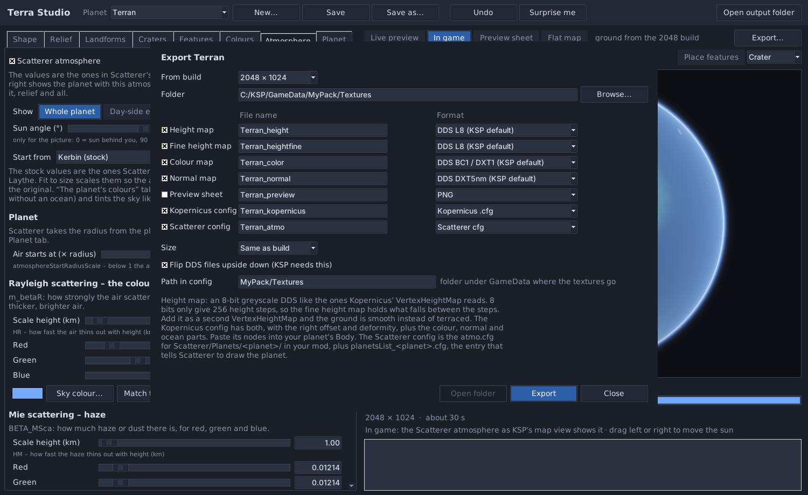

| File | Formats | In Kopernicus |
|---|---|---|
| Height map | DDS L8 (8-bit greyscale), PNG 16-bit or 8-bit | `VertexHeightMap` |
| Fine height map | DDS L8 | a second `VertexHeightMap` |
| Colour map | DDS BC1/DXT1, BC3/DXT5, BC7, PNG, JPG, TGA, BMP | `VertexColorMap` and the `ScaledVersion` texture |
| Normal map | DDS DXT5nm or BC5, PNG | `ScaledVersion` normals |
| Preview sheet | PNG, JPG | |
| Kopernicus config | .cfg | paste its nodes into your planet's `Body` |
| Scatterer config | .cfg | the atmosphere (`atmo.cfg`) and `planetsList_<planet>.cfg` |

An 8-bit height map only has 256 steps. On a planet with 10 km of relief that is 40 m
per step, and the ground looks terraced up close. The fine height map holds what falls
between the steps; added as a second `VertexHeightMap` with a deformity of 1/255 of the
first, the two together are as smooth as a 16-bit map (about 0.1 m). The exported config
does this for you:

```
PQS
{
	Mods
	{
		VertexHeightMap
		{
			map = MyMod/Textures/World_height.dds
			offset = -4542.2
			deformity = 10247.1
			scaleDeformityByRadius = false
			order = 20
			enabled = true
		}
		VertexHeightMap
		{
			map = MyMod/Textures/World_heightfine.dds
			offset = 0
			deformity = 40.18
			scaleDeformityByRadius = false
			order = 21
			enabled = true
		}
		VertexColorMap
		{
			map = MyMod/Textures/World_color.dds
			order = 9999993
			enabled = true
		}
	}
}
ScaledVersion
{
	Material
	{
		texture = MyMod/Textures/World_color.dds
		normals = MyMod/Textures/World_normal.dds
	}
}
```

With an ocean, the config also gets an `Ocean` node in your water colours. The body
then needs a template that has an ocean (for example Kerbin without `removeOcean`).

**Path in config** in the export window is the folder under `GameData` the texture paths
in the config start with, for example `MyMod/Textures`. It fills itself in when you export
straight into a folder inside `GameData`.

Which DDS format to pick:

| Map | Format | When |
|---|---|---|
| Height, fine height | L8 | what Kopernicus' `VertexHeightMap` reads |
| Colour | BC1 / DXT1 | the default; what KSP uses out of the box |
| Colour | BC7 | best quality, twice the file size |
| Colour | BC3 / DXT5 | when you need an alpha channel |
| Normal | DXT5nm | the default; for KSP's own planet shaders |
| Normal | BC5 | for shaders that ask for a BC5 normal map |

BC5 and BC7 need a texture loader that can read them, such as KSPTextureLoader.

DDS files are flipped upside down on export, because KSP expects that. Turn it off in
the export window if you need the files for something else.

### Lava glow

A planet with anything that glows (lava plates, a lava ocean, lava rivers, glowing cracks or
volcanoes) gets an emissive map in its build (`<name>_emissive.png`). Export
writes it as DDS (BC1 / DXT1, or BC7) or PNG, and the Kopernicus config adds it as
`VertexColorMapEmissive` with `blendMode = Additive`, once in the PQS mods and once in the
ScaledVersion, so the lava glows close up and from orbit. With a lava ocean, the Ocean node is
written in the lava colours with the same emissive map in its Mods. That needs Lt_Duckweed's
001_DuckweedUtils (with Kopernicus and ModuleManager). It does not work with Parallax
Continued or Scatterer oceans. **Glow** on the Lava tab sets how bright the map is.

### Scatterer atmosphere

The Atmosphere tab writes a normal Scatterer config. The atmosphere goes into any .cfg
file in your mod, for example `GameData/MyMod/Scatterer/Planets/World/atmo.cfg`:

```
Scatterer_atmosphere
{
	Atmo
	{
		name = World
		atmosphereStartRadiusScale = 1
		HR = 3.84
		HM = 1
		m_betaR = 0.0153408,0.0357075,0.0875489
		BETA_MSca = 0.0121406,0.0121406,0.0121406
		m_mieG = 0.85
		...
		configPoints
		{
			Item
			{
				altitude = 0
				skyExposure = 0.2
				...
			}
		}
	}
}
```

Scatterer only draws planets that are in its planet list, so the tab also gives you the
entry for that:

```
@Scatterer_planetsList:AFTER[Kopernicus]
{
	@scattererCelestialBodies
	{
		Item
		{
			celestialBodyName = World
			transformName = World
			hasOcean = False
			mainSunCelestialBody = Sun
			...
		}
	}
}
```

The units are Scatterer's: HR, HM and the ozone height in km, the scattering values per km.
Scatterer works out the top of the atmosphere from them and takes the radius from the
planet itself (here, the radius on the Planet tab). **Fit to this planet's size** scales
the stock values so the air looks the same on your planet as on Kerbin, Duna, Eve or
Laythe: the heights grow with the radius and the scattering values shrink by the same
amount. The map view uses the last config point (the highest altitude), and so does the
In game view. Scatterer builds its tables in game the first time it sees new values,
which takes a few seconds.

**Save atmo.cfg...** starts in your mod's `Scatterer/Planets/<planet>` folder when there is
one, backs up a file it replaces into `backups/`, and offers to save the planet list entry
next to it. When you turn the atmosphere on and your mod already has a Scatterer config for
a planet of the same name, it asks whether to start from that.

`hasOcean` stays `False`: Scatterer's own ocean needs an ocean config of its own, so the
planet keeps its Kopernicus ocean.

The In game view also shows the clouds, the aurora and the lava glow (switch each one off
on the Atmosphere tab), and works without an atmosphere too. It uses the build when it is up
to date (sharper), otherwise the live preview. It is a close match, not a copy of the game: KSP's own lighting, EVE clouds,
godrays and the rim and shine values are not in it. With an atmosphere, the big globe on
the preview sheet shows it too.

### Clouds

The Clouds tab writes, for every layer (`fair`, `sys0` to `sys3`, `cirrus`):

- `<name>_<layer>_coverage.dds`: where the clouds are (BC4, the size set on the tab; half that
  for cirrus).
- `<name>_<layer>_type.dds`: which cloud type grows there (BC4, half size). Thin stratus where the
  clouds are light, towering congestus in the thickest parts of the weather systems.
- `<name>_<layer>_scaled.dds`: the layer seen from orbit (DXT5, half size).
- `<name>_clouds.cfg`: the `EVE_CLOUDS` config with Edmunds' cloud types (Stratus, Cumulus,
  Congestus), the weather systems' `timeSettings` (they take turns over the cycle) and the cirrus
  layer.

Put the textures where the config's texture path points (**Path in config** in the Export
window) and the .cfg anywhere in your mod. It needs EVE, True Volumetric Clouds and
StockVolumetricClouds. Big maps take a while: 4096 about a minute, 16384 about 15 to 20 minutes
and a lot of memory.

### Aurora

The Aurora tab makes polar lights for EVE. Export writes three files:

- `<name>_aurora.dds`: the lower, main part of the aurora (DXT5 with alpha, or PNG).
- `<name>_aurora_top.dds`: the same curtains in the top colours.
- `<name>_aurora.cfg`: an `EVE_CLOUDS` config with one layer per height. The lowest layers
  use the main texture and the highest ones (**Top layers**) the top texture. Each layer
  is a little more see-through than the one below it, from **Opacity** down to
  **Highest layer opacity**.

Put the textures where the config's texture path points (the **Path in config** in the
Export window) and the .cfg anywhere in your mod. It needs EVE and StockVolumetricClouds (for the uvnoise texture
and an empty coverage map that keeps the layers out of the volumetric clouds). The
**Drift speed** is EVE's `speed`, so the aurora slowly turns around the pole. The tab
also shows the config to copy.

### Hazard map

On the Lava tab, tick **Hazard map** to make the lava, or a deadly sea (acid, molten metal,
anything), hurt craft. It uses Kopernicus' `HazardousBody`: every vessel near the hot ground is
heated towards **Temperature (K)** (`ambientTemp`; most parts burn up somewhere between 1200 and
2500 K). Export writes `<name>_hazard.dds`, a greyscale map in the same layout as the height map
(white = full heat, fading out over **Heat spreads (km)** past the edge), and the Kopernicus
config gets the node with `HeatMap` and an `AltitudeCurve` (Kopernicus measures it from the
planet's centre): full heat up to the highest hot ground, gone **Heat reaches up (m)** above it.
**What is deadly** picks lava (fields, flows and a lava sea), the sea, both, or only the rivers.
With **The rivers carry it too** the rivers from the Landforms tab are deadly as well: the water
rivers when the sea is, the lava rivers when the lava is.

### Rings

Tick **This planet has rings** on the Rings tab. Build writes `<name>_ring.png`, a strip
with alpha whose left end is the outer edge of the ring (the way Kopernicus maps it).
Export saves it as `<name>_ring.dds` (BC3 / DXT5 with alpha, or BC7) or PNG, and the
Kopernicus config gets a `Rings` node with `innerRadius` and `outerRadius` (planet radius =
1000), the tilt as `angle` and the texture path. The tab also shows the node to copy.

## Presets

Every planet is one small JSON file in `presets/`. Thirteen examples come with it:

| Preset | Look |
|---|---|
| Terran | oceans, continents, mountain ranges and polar caps |
| Archipelago | a water world with island chains |
| Riverlands | continents with rivers and valleys, plateaus, a dry belt and a Scatterer atmosphere |
| RedDesert | a dry, Mars-like world with highlands, basins and polar caps |
| RiftDesert | the same with canyons, big volcanoes and an impact basin |
| GreyMoon | an airless moon with craters, rays and dark plains |
| IceMoon | a bright icy moon |
| CrackedIce | an icy moon covered in long crossing cracks, like Europa |
| TornLava | a world close to its star, its day side ripped into lava plates around a lava sea |
| LavaMoon | a small moon torn into plates all over, with lava pools |
| MoltenWorld | an ordinary rocky planet with lava rivers, glowing volcanoes and a lava ocean |
| FlowedMoon | a black, Anneheg-like moon with seas of flowed lava, crust floes and cooled flow lines on the rock |

**New...** starts a planet as a copy of the one you have open, with a new seed. Builds go
to `out/<name>/` (4096) and `out/<name>_<size>/` (other sizes). Every build also saves the
settings it was made with, and the window tells you when the settings changed since.

## Command line

Everything the window does also works from the command line, which is handy for scripts.

```
python terrain.py make Terran --res 4096
python terrain.py export Terran --to export --res 4096 --config --config-path MyMod/Textures
python terrain.py new MyWorld --template GreyMoon
```

`export` options: `--height dds|png|png8|none`, `--fine dds|png|none`,
`--color dds|bc1|bc3|bc7|png|jpg|tga|bmp|none`, `--normal dds|bc5|png|none`,
`--preview png|jpg|none`, `--config`, `--config-path PATH`, `--atmo cfg|none`,
`--aurora dds|png|none`, `--clouds tvc|none`, `--hazard dds|png|none`, `--emissive dds|bc7|png|none`, `--size 2048`, `--no-flip`. The Scatterer config is written when
the planet has an atmosphere, unless you give `--atmo none`, and the aurora when it has
one, unless you give `--aurora none`.

With the Windows download, use `TerraStudio.exe` in place of `python terrain.py`.

## Requirements

- Python 3.9 or newer with numpy and Pillow 11.2 or newer (only when you run it from source)
- About 1 GB of free memory for a 4096 build, about 3 GB for 8192

## Building the Windows version

Double-click `build_release.bat`. It makes its own Python environment in `.buildenv`,
installs numpy, Pillow and PyInstaller there, builds `TerraStudio.exe`, tests it with a
small build and zips it to `release/TerraStudio-<version>-windows-x64.zip`.
